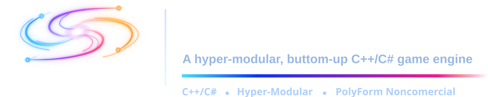

**StellarEngine** (codename **Starlet**) is a hypermodular engine for games and applications. It is written in C++23 and C#/.NET 9, Windows-first, and distributed as source under the PolyForm Noncommercial 1.0.0 license.

## What it is

StellarEngine is a layered engine with one dependency direction:

- **Kernel** — contracts: quants, collections, registries, failures, platform, graphics, resources, logging.
- **Core** — the managed logic and the native core.
- **Runtime** — configuration, module loading, stages, clocks and the main loop.
- **SDK and Tools** — the MSBuild SDK, analyzers, the `stellar` CLI and resource tools.
- **Modules and games** — separate repositories on top of Kernel contracts.

The engine boots through one pipeline: **launcher → runtime → engine → game → main loop**. Modules are loaded into collectible contexts and started by level.

## Status

Pre-release. The current orchestra version is **0.10.0**.

Working: Kernel, Core, Runtime, SDK, Tools, the full launch pipeline, the main loop with frame phases, quants, collections, registries, catalogs, the failure system and the `Stellar.FileSystem` module.

Next: `JobSystem`, the logging runtime, the asset runtime, the WinAPI platform layer and the first graphics backend (DX12, then DX11). The public roadmap tracks the path to the first playable MVP.

## Repositories

- [StellarEngine-Mono](https://github.com/QuantumDevTeam/StellarEngine-Mono) — generated monorepo mirror; do not open work here.
- [Stellar.FileSystem](https://github.com/QuantumDevTeam/Stellar.FileSystem) — file system module.
- [Stellar.LoggingSystem](https://github.com/QuantumDevTeam/Stellar.LoggingSystem) — logging module.
- [Public engine roadmap](https://github.com/orgs/QuantumDevTeam/projects/3/)
- [QuantumHub](https://github.com/QuantumDevTeam/QuantumHub) — desktop hub for the ecosystem.

The editor and the wider ecosystem — MirageAPI, Nebula, Chronos, Pulsar, Prometheus — are in design or early development.

## Links

- Documentation: https://quantumdevteam.github.io/StellarEngine-Mono/
- Roadmap: https://github.com/orgs/QuantumDevTeam/projects/3/
- Releases: https://github.com/QuantumDevTeam/StellarEngine-Mono/releases
- Organization: https://github.com/QuantumDevTeam

## License

PolyForm Noncommercial 1.0.0. The engine is source-available, not OSI open source. Commercial use requires a separate agreement with QuantumDevTeam.

External contributions require the [CLA](https://github.com/QuantumDevTeam/.github/blob/master/licensing/CLA.md).
