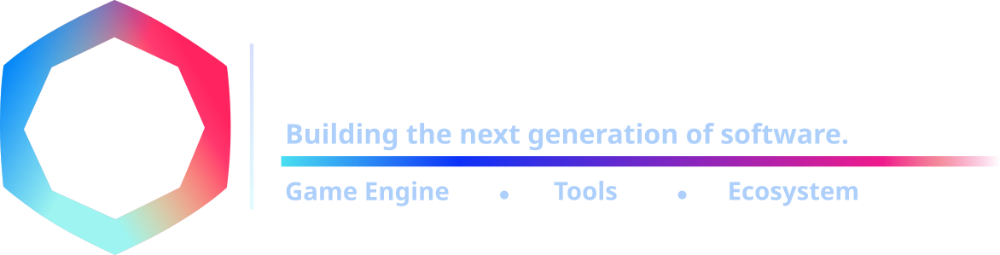

**Game engine and tools development.**

We build **StellarEngine** (codename **Starlet**) - a hypermodular engine for games and applications. It is written in C++23 and C#/.NET 9, Windows-first, and distributed as source under the PolyForm Noncommercial 1.0.0 license.

## Repositories

- [StellarEngine Mono-repo](https://github.com/QuantumDevTeam/StellarEngine-Mono) - generated monorepo mirror; do not open work here.
- [QuantumHub](https://github.com/QuantumDevTeam/QuantumHub) - desktop hub for the ecosystem.
- [Public engine roadmap](https://github.com/orgs/QuantumDevTeam/projects/3/) - what is being built and what comes next.
- Modules: Stellar.FileSystem, Stellar.LoggingSystem, Stellar.Stage and etc.

The editor and the wider ecosystem - MirageAPI, Nebula, Chronos, Pulsar, Prometheus - are in design or early development. They will be published when they are ready.

## Status

Pre-release. The current orchestra version is **0.10.0**. The engine already boots through the full pipeline - launcher -> runtime -> engine -> game -> main loop - and the roadmap tracks the path to the first playable MVP.

## Working with us

- Use the issue tracker of the component repository.
- `StellarEngine-Mono` is a mirror; changes are made in the component repositories.
- External contributions require the CLA in the component repository.
- The engine is source-available, not OSI open source. Commercial use requires a separate agreement with QuantumDevTeam.

## Links

- Documentation: https://quantumdevteam.github.io/StellarEngine-Mono/
- Roadmap: https://github.com/orgs/QuantumDevTeam/projects/3/
- Releases: https://github.com/QuantumDevTeam/StellarEngine-Mono/releases